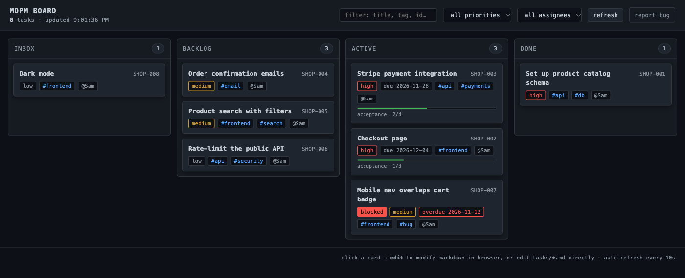

# MDPM — Markdown Project Manager

[](https://github.com/Hank95/mdpm/actions/workflows/tests.yml)
[](https://github.com/Hank95/mdpm/releases)
[](./LICENSE)
[](https://github.com/Hank95/mdpm)
[](https://python.org)

A lightweight, markdown-native project tracker for [Claude Code](https://claude.ai/code). Tasks live as `.md` files with YAML frontmatter; **status is a directory**. Zero dependencies: a Python standard-library CLI, a local kanban board, and a handful of slash commands.

> For developers and hybrid PM/engineers who want the lightest possible tracking system that works equally well for humans and AI coding agents — and who occasionally need to surface status to stakeholders in Jira or Wrike without context-switching.



---

## Why MDPM?

- **Markdown is the source of truth.** No database, no API, no web service required. Everything is a file in your repo.
- **Status is a directory.** `tasks/backlog/`, `tasks/active/`, `tasks/done/`, `tasks/inbox/`. `ls` tells you the state of the project.
- **One file per task.** Claude can read or edit a single task without loading the whole system.
- **Never delete history.** Task files move between directories; the work log is append-only.
- **AI-friendly by design.** The conventions were written so Claude Code can do project management work alongside actual engineering work, in the same session.
- **Experimental Jira / Wrike bridges.** For when stakeholders need to see status somewhere else. MDPM works 100% standalone if you never enable them.

---

## Install

MDPM is a Claude Code plugin. **Install it from within your project directory** so skills load in that project's context:

```bash
cd your-project/   # navigate to the repo you want to use MDPM in
```

Then in Claude Code (one command at a time):

```
/plugin marketplace add Hank95/mdpm
/plugin install mdpm@mdpm
/reload-plugins
```

> **Scope matters.** Install from inside the project where you'll use MDPM. A global install may not load skills in per-project sessions. If `/pm-help` returns "Unknown skill" after install, reinstall from within the project directory.

(Or clone the repo and point Claude Code at a local path — see [Development](#development).)

Once installed, run inside any repo:

```
/pm-config
```

That walks you through first-time setup (ID prefix, default assignee, optional sync config) and creates the `tasks/` and `docs/` layout.

From then on, every Claude Code session started inside that repo gets MDPM's rules added to its context by a `SessionStart` hook, so Claude knows to use the CLI for task changes without being told. The hook prints nothing in repos that have no `.mdpm/config.json`.

---

## Two surfaces: slash commands and CLI

MDPM exposes the same operations two ways:

- **`/pm-*` slash commands** — for the operations where Claude's judgment adds something: a dashboard, a recommendation, breaking a feature into tasks, triaging an inbox, writing a standup.
- **`bin/mdpm` CLI** — a deterministic, stdlib-only Python CLI for scripts and for Claude to use inline. Every operation is atomic, appends work log entries automatically, validates input, and returns structured JSON on `--json` (before or after the subcommand).

The slash commands call the CLI, and the CLI and board share `lib/mdpm_core.py`, so there is one implementation of every rule. Operations without a slash command (block, edit, search, archive) need none: say "block PRJ-042, waiting on Alice" and Claude runs `mdpm block`. The session hook tells Claude to use the CLI rather than `sed` / `mv` on task files.

Quick CLI tour:

```bash
# Any operation the slash commands do, without the conversational overhead:
mdpm new "Fix broken login" --priority high --tags auth,bug
mdpm start PRJ-042
mdpm log PRJ-042 "integrated with auth provider"
mdpm block PRJ-042 waiting on security review from Alice
mdpm unblock PRJ-042
mdpm done PRJ-042 -m "Shipped with MFA"
mdpm next --json            # structured output for scripting
mdpm status                 # project dashboard
mdpm search "gallery"       # find tasks
mdpm archive --older-than 30
```

Run `mdpm --help` or `mdpm <command> --help` for full argument lists.

## Commands

All slash commands are prefixed with `/pm-`.

### Daily use

| Command | What it does |
| --- | --- |
| `/pm-status` | Dashboard — active work, priorities, blockers (vs waiting), overdue, recently shipped |
| `/pm-next` | Recommends the single best task to start next |
| `/pm-new <title>` | Creates a new backlog task with auto-incrementing ID |
| `/pm-start <id>` | Moves a backlog task to `active/` and begins work |
| `/pm-done <id>` | Completes a task, moves to `done/`, checks for unblocked dependents |
| `/pm-standup [audience]` | Generates a stakeholder-ready standup summary |

### Planning & triage

| Command | What it does |
| --- | --- |
| `/pm-plan <feature>` | Breaks a feature into 3–8 tasks with dependency mapping |
| `/pm-inbox` | Walks through `tasks/inbox/` one item at a time |

### Board

| Command | What it does |
| --- | --- |
| `/pm-board [port]` | Prints the command to launch the local kanban board |

### CLI only — just ask Claude, or run it yourself

| CLI command | What it does |
| --- | --- |
| `mdpm block <id> <reason>` / `mdpm unblock <id>` | Marks a task blocked (status field) with the reason in the work log |
| `mdpm edit <id> [--priority …] [--due …] [--tags …]` | Change title, priority, due date, tags, assignee, dependencies |
| `mdpm search <query>` | Find tasks by ID, title, tag, or anything in the body |
| `mdpm archive [--older-than N]` | Moves aged `done/` tasks to `tasks/archive/` to reduce clutter |

### Experimental sync (requires an MCP server for the target system)

| Command | What it does |
| --- | --- |
| `/pm-sync-jira [push\|pull\|both]` | Syncs task state with Jira via any connected Jira MCP |
| `/pm-sync-wrike [push\|pull\|both]` | Syncs task state with Wrike via any connected Wrike MCP |

### Setup / reference

| Command | What it does |
| --- | --- |
| `/pm-config` | First-time setup (or reconfigure) |
| `/pm-help` | Lists all commands |

---

## Task Format

Every task lives in `tasks/<status>/<slug>.md`:

```yaml
---
id: PRJ-001
title: Gallery Page Component
priority: high            # high | medium | low
status: backlog           # backlog | active | blocked | done
created: 2026-04-10
updated: 2026-04-10
due: 2026-04-18
tags: [gallery, frontend]
depends_on: []
assigned_to: Henry
wrike_id: null
jira_id: null
jira_project: null
---

# Gallery Page Component

## Objective
Build the responsive gallery page for BTR community sites as part of the platform rebuild.

## Acceptance Criteria
- [ ] Lightbox viewer with swipe support on mobile
- [ ] Lazy loading for images below the fold
- [ ] Responsive grid layout — 1 col mobile, 2 col tablet, 3 col desktop
- [ ] Accessible (keyboard navigation, alt text, focus management)

## Notes
Check with design on the approved mockup. Coordinate with infra if CDN changes are needed.

## Work Log
- 2026-04-10: Task created, scoped initial requirements
```

See [`examples/PRJ-001-gallery-page-component.md`](examples/PRJ-001-gallery-page-component.md) for a full example.

MDPM reads a small subset of YAML: `key: value` scalars, `[inline, lists]`, `- block` lists, quoted strings, `#` comments, and `|` / `>` block scalars. When it rewrites a task it only touches the lines for fields that changed, so comments, formatting, and any YAML it doesn't understand are left exactly as you wrote them.

---

## Directory Layout (after `/pm-config`)

```
your-project/
├── .mdpm/
│   ├── config.json          # MDPM project config (committed)
│   └── sync-state.json      # sync cache (gitignored)
├── tasks/
│   ├── inbox/               # untriaged incoming requests
│   ├── backlog/             # prioritized queue
│   ├── active/              # in progress
│   └── done/                # shipped (never delete)
├── docs/
│   ├── ROADMAP.md           # milestones and priorities
│   ├── DECISIONS.md         # ADR log
│   └── CHANGELOG.md         # shipped work, newest first
└── CLAUDE.md                # references the MDPM rules
```

---

## Kanban Board

A zero-dependency local board ships with the plugin:

```bash
python3 ${CLAUDE_PLUGIN_ROOT}/bin/mdpm board
# -> opens http://127.0.0.1:8765 in your default browser

# Useful flags:
#   --port N         different port (default 8765, auto-walks forward if busy)
#   --no-open        don't open a browser (good for SSH/Tailscale sessions)
#   --host 0.0.0.0   bind beyond loopback (only on trusted networks — the
#                    board has write endpoints)
```

The `board` subcommand locates `serve.py` inside the installed plugin and points it at whatever project you're in, so you always get the current UI after `/plugin update mdpm`.

- Pure Python stdlib (`http.server`)
- Single-file HTML, dark terminal aesthetic
- Four columns: Inbox, Backlog, Active, Done
- Cards show priority, tags, due dates (with overdue warnings), blocked state, acceptance progress
- Click a card for the full objective, notes, and latest work log
- **Inline editing**: the detail modal has an **Edit** button that opens the full raw markdown in a textarea. Save writes back to the file with conflict detection (mtime-based) — if the file changed on disk while you were editing, you'll be prompted to reload or overwrite. Cmd/Ctrl+S saves.
- Auto-walks the port forward if the default (8765) is busy (use `--strict-port` to disable)
- Refuses writes from other web origins and requests with a non-local `Host` header, so a page open in another tab can't edit your tasks through the board

No build step, no npm, no watcher.

---

## Sync — Jira and Wrike (experimental)

> **Experimental.** Unlike the rest of MDPM, sync has no code behind it. `/pm-sync-jira` and `/pm-sync-wrike` are instructions that Claude carries out with whatever Jira or Wrike MCP server you have connected, so behavior depends on that server and is not covered by the test suite. Claude lists the changes it intends to make and asks before touching the external system.

Sync is an **optional bridge** for surfacing local task state to stakeholders.

- **MCP-agnostic.** MDPM discovers available Jira/Wrike tools at runtime. It doesn't ship its own server.
- **Graceful degradation.** If no MCP is connected, the sync command prints a copy/pasteable standup summary instead of failing.
- **Incremental.** Only deltas since the last sync are pushed (state is cached in `.mdpm/sync-state.json`).
- **Push + pull.** Push local state outward, or pull newly assigned external issues into `tasks/inbox/` for triage.

### Field mappings

**Jira**

| MDPM field | Jira field |
| --- | --- |
| `title` | Summary |
| Objective + Acceptance Criteria | Description |
| `priority` | Priority |
| `tags` | Labels |
| `status` | Workflow transition |
| `due` | Due date |
| `assigned_to` | Assignee |
| `jira_id` | Issue key |
| `jira_project` | Project key |
| Work Log entries | Comments |

**Wrike**

| MDPM field | Wrike field |
| --- | --- |
| `title` | Title |
| Objective + Acceptance Criteria | Description |
| `priority` | Priority |
| `tags` | Tags |
| `status` | Custom status (via config map) |
| `due` | Due date |
| `assigned_to` | Assignee |
| `wrike_id` | Task ID |
| Work Log entries | Comments |

To enable: install any Jira or Wrike MCP server (e.g. the official Atlassian MCP), register it in your `.mcp.json`, and run `/pm-sync-jira` or `/pm-sync-wrike`.

---

## Configuration

`/pm-config` writes `.mdpm/config.json`:

```json
{
  "id_prefix": "PRJ-",
  "default_assignee": "Henry",
  "stakeholders": [],
  "jira": {
    "default_project": "ENG",
    "status_map": {
      "backlog": "To Do",
      "active": "In Progress",
      "blocked": "Blocked",
      "done": "Done"
    },
    "priority_map": {
      "high": "High",
      "medium": "Medium",
      "low": "Low"
    }
  },
  "wrike": {
    "folder_id": null
  }
}
```

Edit this file directly to change behavior, or rerun `/pm-config`.

---

## Design Principles

1. **Markdown first.** If you ever walk away from MDPM, your history is still plain files.
2. **Directories over fields.** Filesystem state is self-documenting; a stale `status:` frontmatter field doesn't lie about where a file lives.
3. **Small, focused tasks.** If a task takes more than a couple of days, decompose it.
4. **Append-only history.** Never rewrite work logs.
5. **No lock-in.** Sync to Jira/Wrike is opt-in, and the markdown files stay the source of truth: pulled issues land in `inbox/` for triage rather than overwriting local tasks.
6. **Claude-native.** Conventions written so an AI coding agent can do PM work alongside engineering in the same session.

---

## Engineering Notes

A few decisions that shaped the code, and what they cost:

- **A hand-written YAML subset instead of PyYAML.** Zero dependencies means the plugin works the moment it is installed, with no `pip` step inside someone else's project. The cost is that MDPM can't understand all of YAML — so it never re-serializes a whole file. Rewrites go through `merge_frontmatter`, which reuses the original lines for every field whose value didn't change. `tests/test_frontmatter.py` pins that down: an unchanged file must come back byte-identical.
- **One core library, two front ends.** The CLI and the board server both import `lib/mdpm_core.py`, so "what is a task" and "how is it written" are defined once.
- **Deterministic CLI under the slash commands.** Asking a model to move files and edit frontmatter by hand works most of the time, which isn't good enough for a tracker. Every mutation is a CLI call with an atomic write, stable JSON output, and distinct exit codes; the model decides *what* to do and the CLI does it.
- **Rules arrive by hook, only where wanted.** `mdpm session-context` prints the agent rules only when it finds `.mdpm/config.json` at or above the working directory — a bare `tasks/` folder in an unrelated repo doesn't trigger it.
- **The board treats the browser as hostile.** It is a localhost server with a write endpoint, so it checks `Host` (DNS rebinding) and `Origin` / `Content-Type` (cross-site POSTs). `tests/test_board.py` covers each case over a real socket.

Known limits: no file locking, so two processes creating tasks at the same instant can race for an ID; and the Jira/Wrike sync is prompt-driven and untested (see above).

---

## Troubleshooting

**`/pm-help` returns `Unknown skill: pm-help` after install.**

Most common cause: **wrong install scope.** MDPM must be installed from within the project directory where you'll use it. A global install shows the plugin as "installed" but skills don't load in per-project sessions.

Fix: `cd` into your project, then clean-reinstall:

```
/plugin uninstall mdpm
/plugin marketplace remove mdpm
/plugin marketplace add Hank95/mdpm
/plugin install mdpm@mdpm
/reload-plugins
/pm-help
```

If the skill count in `/reload-plugins` doesn't increase by 13, the install landed at the wrong scope. Make sure you're inside the project directory when you run the install commands.

**`/plugin marketplace add` opens a TUI prompt on mobile / tmux sessions.** Paste only the source (`Hank95/mdpm`) into the text box — not the whole sequence of commands. Then run `/plugin install mdpm@mdpm` separately.

**Board server says port is busy.** `mdpm board` auto-walks forward to the next free port starting at 8765. Pass `--port <N>` to start somewhere else, or `--strict-port` to fail instead of falling back.

---

## Updating

Users can pull new versions with:

```
/plugin marketplace update mdpm
/plugin update mdpm
```

Releases are tagged with semver git tags (e.g. `v0.7.0`). The `version` field in both `.claude-plugin/plugin.json` and `.claude-plugin/marketplace.json` must match the tag.

---

## Development

Clone and point Claude Code at the local plugin:

```bash
git clone https://github.com/Hank95/mdpm
cd mdpm
# In Claude Code:
/plugin install ./mdpm
```

Run the tests (standard library only — nothing to install):

```bash
python3 -m unittest discover -s tests
```

Contributions welcome — open an issue or PR. See [CONTRIBUTING.md](./CONTRIBUTING.md).

Project structure:

```
mdpm/
├── .claude-plugin/
│   ├── plugin.json          # plugin manifest
│   └── marketplace.json     # marketplace listing
├── bin/mdpm                 # the CLI
├── lib/mdpm_core.py         # task parsing and file operations (shared by CLI and board)
├── skills/                  # one /pm-<name> skill per subdirectory (SKILL.md)
├── hooks/hooks.json         # SessionStart hook: runs `mdpm session-context`
├── rules/
│   └── project-tracking.md  # conventions; the hook injects the first section
├── templates/               # files copied into user repos during /pm-config
│   ├── CLAUDE.md
│   ├── docs/
│   └── tasks/
├── board/
│   ├── board.html           # kanban UI
│   └── serve.py             # stdlib HTTP server
├── tests/                   # unittest suite (run in CI on Python 3.9 and 3.13)
├── examples/                # sample task files
└── LICENSE
```

---

## License

MIT — see [LICENSE](./LICENSE).
